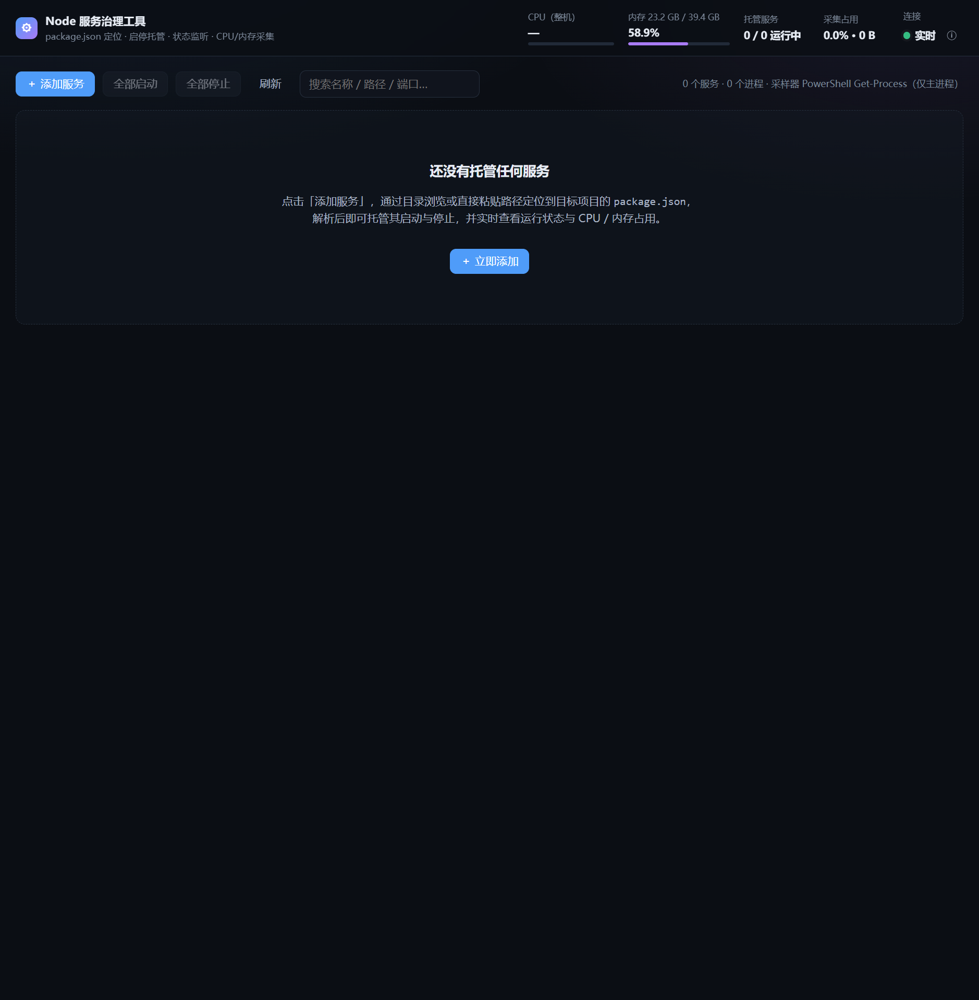
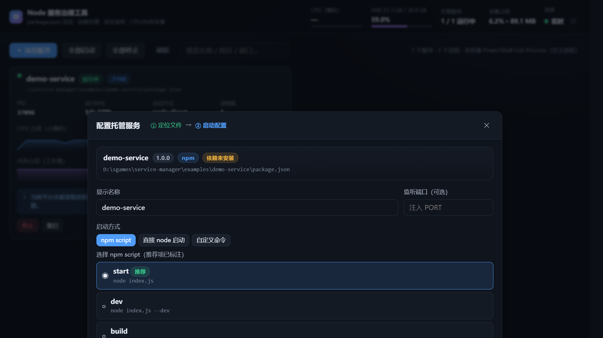
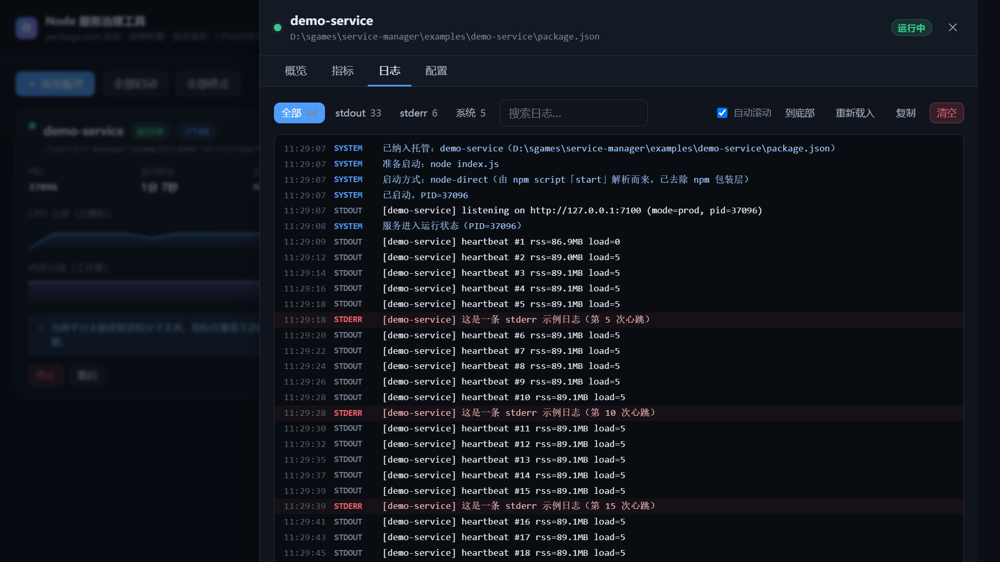
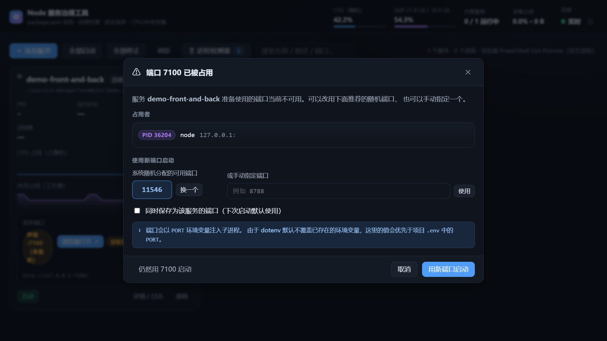

# Node 服务治理工具（service-manager）

基于 **Node.js + Vue 3** 的本地服务治理控制台：手动定位到任意 Node 服务的 `package.json`，
把它纳管进来，之后在这个界面里完成 **启动 / 停止 / 重启**、**实时状态监听**、**日志查看**，
并持续采集该服务的 **CPU 与内存占用**。

> 面向本机运维场景：只监听 `127.0.0.1`，不依赖任何数据库、Docker 或外部 Agent。

---

## 功能一览

| 能力 | 说明 |
| --- | --- |
| 手动定位 `package.json` | 三种方式：**目录逐级浏览**（自动高亮含 `package.json` 的目录）、**直接粘贴绝对路径**、**指定目录批量扫描**（按深度发现多个项目） |
| 解析服务元信息 | 名称/版本/描述、全部 npm scripts（自动标注推荐的启动脚本）、入口文件、包管理器与 lock 文件、依赖数量、`node_modules` 是否已安装 |
| 托管启动与停止 | 支持 npm script / 直接 node 启动 / 自定义命令三种模式；停止时整棵进程树一起回收 |
| 运行状态监听 | `stopped / starting / running / stopping / exited / crashed / orphaned` 七态；SSE 实时推送，无需刷新页面 |
| CPU / 内存采集 | 默认 3s 采样，卡片上直接画 CPU 与内存曲线；详情页可看单进程明细（PID / 进程名 / 占用） |
| 监听端口探测 | 实时探测服务**真正在监听**的端口（TCP/UDP、绑定地址），而不是只看配置里声明的数字；停止后自动清空 |
| 浏览器入口 | 卡片与详情页都有「浏览器打开 ↗」，一键直达服务页面；入口地址可由探测到的端口自动推导，也可手工指定（支持 https / 内网域名 / 带路径） |
| 端口占用预检 | 启动前检查目标端口；被占用时弹窗显示**谁占用了它**（PID/进程名/是否另一个托管服务），并随机分配一个可用端口，也可手动填写 |
| Node 进程检测器 | 默认隐藏的侧边栏，一键展开后列出本机所有 node 进程（PID / 内存 / CPU / 各自监听的端口 / 命令行），并**标记出属于已托管服务的那些** |
| 日志 | 子进程 stdout/stderr 落盘留存 + 内存环形缓冲，支持按流筛选、关键字搜索（高亮）、自动滚动、复制、清空；管理端重启后仍可回溯历史日志。**自动清洗 ANSI 颜色码与进度条回车覆盖**，不会出现 `[2m[36m` 这类乱码 |
| 异常处理 | 异常退出自动重启（指数退避，最多 5 次/分钟，可选）；管理端重启后能识别「进程还在但已脱离托管」的残留服务并一键终止 |
| 批量操作 | 全部启动 / 全部停止 |

### 界面截图

| 空状态（引导） | 运行中（实时指标曲线） |
| --- | --- |
|  |  |

| 定位 package.json（目录浏览） | 启动配置（脚本选择） | 日志查看器 |
| --- | --- | --- |
|  |  |  |

| 卡片上的监听端口与浏览器入口 | 详情页：端口明细 + 入口 |
| --- | --- |
|  |  |

| 端口占用预检（冲突时弹窗） | Node 进程检测器（默认隐藏，可展开） |
| --- | --- |
|  |  |

---

## 快速开始

```bash
# 1. 安装依赖（只有 express + vue，无原生模块、无 postinstall 脚本）
npm install

# 2. 构建前端（用 @vue/compiler-sfc 编译 SFC → 浏览器原生 ESM，约 0.3 秒）
npm run build

# 3. 启动治理服务端（同时托管前端静态资源）
npm start
```

打开 <http://127.0.0.1:5178> 即可。

开发模式（改后端自动重启、改前端自动重新编译，刷新浏览器生效）：

```bash
npm run dev
```

### 想先用一个真实服务试试？

仓库自带一个示例服务：

```bash
npm run build && npm start
```

然后在界面点「添加服务」→「直接输入路径」，粘贴
`<仓库路径>/examples/demo-service/package.json` → 解析 → 启动。
示例服务会在 `7100` 端口起一个 HTTP 服务，周期性打日志，并且可通过
`http://127.0.0.1:7100/load/up` 人为制造 CPU 负载，方便观察曲线变化。

---

## 使用说明

### 1. 定位并纳管服务

点击 **添加服务**，在第一步「定位文件」里有三种方式：

- **浏览目录**：从盘符开始逐级进入。当前目录存在 `package.json` 时该行会高亮成绿色，
  点一下即选中；顶部有面包屑与「上级」按钮，右侧显示子目录数量。
- **直接输入路径**：粘贴 `package.json` 的绝对路径；也可以直接粘贴**项目目录**，会自动补 `/package.json`。
- **批量扫描**：填目录 + 深度（1~4 层），自动跳过 `node_modules`、`.git`、`dist` 等目录，
  一次列出所有可纳管的项目。

选中后进入第二步「启动配置」：

| 字段 | 说明 |
| --- | --- |
| 显示名称 | 默认取 `package.json` 的 name |
| 监听端口 | 可选；填了会以 `PORT` 环境变量注入子进程 |
| 启动方式 | `npm script` / `直接 node 启动` / `自定义命令` |
| npm script | 下拉列出全部 scripts，推荐项已标注（优先级：start > dev > serve > …） |
| 附加参数 | 空格分隔，支持引号，会追加到命令尾部 |
| 环境变量 | 每行 `KEY=VALUE` |
| 异常退出自动重启 | 开启后崩溃会指数退避重启，1 分钟内最多 5 次 |
| 纳管后立即启动 | 勾选则保存后直接拉起 |

### 2. 启停与状态

服务卡片上的操作按钮随状态变化：

- 停止 / 异常退出 → 显示 **启动**
- 运行中 → 显示 **停止** / **重启**
- 外部运行中（残留进程）→ 显示 **终止残留进程**

状态含义：

| 状态 | 含义 |
| --- | --- |
| `running` | 运行中（已存活超过 1.2s 的启动保护期） |
| `starting` | 已 spawn，等待进入稳定运行 |
| `stopping` | 正在停止，等待进程树退出 |
| `stopped` | 由本工具正常停止 |
| `exited` | 自行退出且退出码为 0（如正常处理完任务） |
| `crashed` | 退出码非 0，或停止超时 |
| `orphaned` | 管理端重启后发现上次托管的进程仍在运行 —— 一键终止即可 |

### 3. 查看指标

服务卡片上有两条迷你曲线：

- **CPU 占用（占整机）**：任务管理器口径，多核机器上单核跑满约为 `100 / 核数 %`。
  详情页同时给出「单核基准」口径（top / pidusage 口径），单核跑满为 100%。
- **内存占用（工作集）**：包含共享页，与任务管理器的「内存」列接近。

详情抽屉的「指标」页有放大曲线与采样信息；「概览」页有进程明细表（PID / 进程名 / 角色 / 内存 / CPU）。

### 4. 监听端口与浏览器入口

每个服务会**实时探测它真正在监听哪些端口**，而不是只显示配置里写的数字：

- 卡片上的「监听端口」标签显示探测结果（TCP 蓝色 / UDP 紫色），鼠标悬停可看到绑定地址；
- 服务没起来、端口还没 bind 时这里为空，只会用琥珀色标注「声明 :7100（未监听）」；
- 详情抽屉「概览」页给出完整明细：协议、绑定地址、端口，以及每个 TCP 端口的单独「打开 ↗」。

**浏览器入口**的推导顺序：

1. 配置里填了「浏览器入口地址」→ 原样使用（支持省略协议，会自动补 `http://`）；
2. 否则取探测到的 TCP 端口（优先配置声明的那个）→ `http://127.0.0.1:<端口>/`；
3. 服务未运行时退化为配置声明的端口，保证入口始终可点。

点「浏览器打开 ↗」会在新标签页打开入口地址（标准 `<a target="_blank">`，不受弹窗拦截影响）。
如果服务绑定在 `0.0.0.0` 且你从另一台机器访问本控制台，`127.0.0.1` 会指向你自己的机器 ——
这时在「配置」页把入口地址填成实际可达的地址（如 `http://192.168.1.20:7100/`）即可。

端口探测同样按平台能力自动降级：

| 平台 | 实现 | 说明 |
| --- | --- | --- |
| Windows | `netstat -ano` | 系统自带、普通用户可读；不依赖被拒的 WMI/CIM |
| Linux | `/proc/net/tcp{,6}` + `/proc/<pid>/fd` | 用 socket inode 精确匹配到进程，无需任何外部命令 |
| macOS | `lsof -nP -iTCP -sTCP:LISTEN` | 系统自带 |

探测周期默认 5s（比指标采样慢一档，端口变化不频繁），一次刷新覆盖所有服务。

### 5. 端口占用预检

点「启动」时会**先检查目标端口**，只有确认被占用才会打断你：

1. 端口空闲 → 直接启动，不增加任何多余点击；
2. 端口被占用 → 弹出对话框，包含
   - **占用者信息**：PID、进程名、绑定地址，若占用者是另一个托管服务会直接点明；
   - **系统随机分配的可用端口**（默认选中，可反复「换一个」）；
   - **手动指定端口**输入框；
   - 「同时保存为该服务的端口」勾选项；
   - 「仍然用原端口启动」的兜底入口。

预检的端口来源按优先级取：请求里显式指定 → 服务配置的 `port` → 上次实际探测到的 TCP 端口。
服务正在运行时跳过预检（那时端口当然「被占用」，是它自己）。

判定手段是「端口表反查 + 绑定测试」双保险：先用系统端口快照反查归属 PID，
查不到再真正尝试绑定一次；若绑定失败但快照里也没有，会**强制重扫一次端口表**，
避免刚起来的进程定位不到占用者。

> **顺带一个实用结论**：勾选保存后，端口会以 `PORT` 环境变量注入子进程。
> 由于 dotenv 默认**不覆盖**已存在的环境变量，这里的值会优先于项目 `.env` 里的 `PORT`。
> 当前后端代理目标写死在别处（例如 vite 的 `API_TARGET`）而两边不一致时，
> 用治理工具统一端口是最省事的修法 —— 详见文末的排查案例。

**崩溃后诊断**：如果端口冲突没被预检拦住（例如服务没配端口、或应用把端口写在代码里），
进程会带着 `EADDRINUSE` 退出。此时工具会：

1. 在进程退出时**强制把尚未轮询到的日志读完**（快速崩溃时 `exit` 事件往往早于 250ms 的日志轮询）；
2. 从日志里认出 `EADDRINUSE` 与端口号（兼容 `127.0.0.1:8787`、`:::8787`、以及 stack 里的 `port: 8787`）；
3. 反查占用者，并查明它是不是另一个托管服务；
4. 卡片上直接给出可读结论与「换端口启动」按钮：

   > ⚠ 端口 8787 已被托管服务「hunyuan3d-workbench」（PID 11528）占用　`[换端口启动]`

同时这个端口会被记住，**下次点「启动」时预检直接拿它提前拦截**，不会让你再崩一次。

### 6. Node 进程检测器

顶栏的「🖥 进程检测器」按钮会展开右侧栏（**默认隐藏**，开关状态记在浏览器本地）：

- 列出本机**所有 node 进程**：PID、父进程、内存、CPU、各自监听的端口、命令行（能拿到时）、启动时间；
- 属于已托管服务的进程会**高亮并打上服务名标签**，点一下直接跳到该服务的详情抽屉；
- 「仅已托管」过滤、按 PID / 端口 / 命令 / 服务名搜索；
- 「刷新」立刻重新枚举（默认 5s 自动刷新，可关）；
- 面板头部显示当前**枚举来源**，例如「复用进程快照（完整枚举）」或
  「Get-Process 降级枚举（无进程树/命令行）」，不会假装拿到了没有的数据。

它解决的正是「我只看到前端起来了，后端呢？」这类问题：monorepo 下一个服务往往有
concurrently → npm → tsx/vite 好几个进程，在这里能一次看全，并且每个进程都带端口。

### 7. 查看日志
详情抽屉的「日志」页：

- 按 `全部 / stdout / stderr / 系统` 筛选，带条数统计
- 关键字搜索并高亮
- 自动滚动开关、「到底部」、「重新载入」（从磁盘重读）、「复制」、「清空」
- 底部显示内存缓冲行数与 stdout 落盘路径

日志是**先落盘再展示**的：子进程的 stdout/stderr 直接重定向到
`data/logs/<服务ID>.out.log` 与 `.err.log`（文件描述符 stdio，不走管道），
管理端再以 250ms 轮询增量读取。因此管理端重启后历史日志仍在。

---

## 设计要点

### 启动方式解析：为什么尽量绕开 npm 包装层

`npm run xxx` 会额外拉起 `cmd.exe → npm → node` 三层进程。如果只统计根进程的 CPU/内存，
拿到的其实是 `cmd.exe` 的数字，毫无意义。所以本工具会尽力**把 npm script 还原成直接可执行的形式**：

| mode | 触发条件 | 实际执行 | 意义 |
| --- | --- | --- | --- |
| `node` | 启动方式选「直接 node 启动」 | `node <入口文件>` | 根进程即服务进程 |
| `node-direct` | script 内容是 `node xxx.js` | `node xxx.js` | 去掉 npm 包装层 |
| `node-bin` | script 首个 token 能在 `node_modules/.bin` 找到 | `node <bin 指向的 JS>` | 从 `.cmd`/shim 里解析出真实 JS 入口 |
| `npm-cli` | 以上都不匹配 | `node <npm-cli.js> run <script>` | 保留 npm 完整语义（PATH 注入等） |
| `npm-shell` | 找不到 `npm-cli.js` | shell 执行 `npm run <script>` | 最后兜底 |
| `custom` | 选「自定义命令」 | shell 执行自定义命令 | 支持 `pnpm`/`tsx` 等任意命令 |

界面「概览」页会明确显示实际执行的 mode 与命令行，不猜、不藏。

### 指标采集：按平台能力自动降级

| 平台 | provider | 进程树 | 实现 |
| --- | --- | --- | --- |
| Linux | `proc` | ✅ | 直接读 `/proc/<pid>/stat` + 全表 ppid |
| macOS | `ps` | ✅ | `ps -axo pid=,ppid=,rss=,time=,comm=` |
| Windows（WMI 可读） | `wmi` | ✅ | PowerShell `Get-CimInstance Win32_Process` 一次枚举全表 |
| Windows（WMI 被拒） | `basic` | ❌ 仅主进程 | PowerShell `Get-Process -Id <pids>` |

采集器启动时探测一次能力并缓存，降级时会在界面顶部与卡片上明确提示：

> 当前平台未能读取进程父子关系，指标仅覆盖主进程。使用「直接 node 启动」可获得最准确的数据。

**CPU 百分比**由两次采样的累计 CPU 时间差除以墙钟时间得到（Windows 用
`KernelModeTime + UserModeTime`，单位 100ns；Linux 用 `utime + stime`；macOS 解析 `ps` 的 `time` 列），
因此需要至少两个采样点后才会出现非零值。

### 日志为什么用文件描述符而不是管道

- 子进程写管道时，若管理端读取不及时会**写阻塞**，拖慢甚至卡死被托管服务；
- 受限运行环境（例如某些沙箱）禁止创建命名管道，`stdio: 'pipe'` 会直接 `EPERM`；
- 落盘后天然具备历史留存能力。

代价是实时性依赖 250ms 轮询（对运维查看完全够用）。

### 停止与进程树回收

- **Windows**：`taskkill /PID <pid> /T`（优雅，对无窗口的控制台程序通常无效）→ 短暂等待 →
  `taskkill /PID <pid> /T /F` → 若 `taskkill` 本身不可用，最后用 Node 原生 `process.kill` 兜底。
- **POSIX**：子进程以 `detached: true` 启动独立进程组，停止时对 `-pgid` 发 `SIGTERM`，
  超时后 `SIGKILL`，保证 `npm/pnpm` 之类的包装层不留孤儿。

> 说明：Windows 没有真正的 `SIGTERM`，`process.kill` 等价于 `TerminateProcess`，
> 因此 Windows 上的停止本质是强制终止（与 PM2 行为一致）；POSIX 上才有优雅退出窗口。

---

## 目录结构

```
service-manager/
├── package.json                # 只有 express + vue 两个直接依赖
├── vite.config.js              # 【可选】想用 Vite/HMR 时的配置，默认链路不使用
├── server/src/
│   ├── index.js                # Express 路由 + SSE + 采样循环 + 静态托管
│   ├── config.js               # 路径/端口/采样周期等常量
│   ├── store.js                # 服务清单持久化（data/services.json，原子写）
│   ├── packageScanner.js       # package.json 定位/解析/目录浏览/批量扫描
│   ├── pm.js                   # 进程管理器：启动计划解析、启停、状态机、进程树终止
│   ├── metrics.js              # 跨平台进程指标采集与进程树聚合
│   ├── ports.js                # 监听端口探测（netstat / /proc / lsof）、占用反查、随机可用端口
│   ├── logs.js                 # 日志落盘 + 增量 tail + 环形缓冲
│   └── util.js                 # 进程存活探测、参数转义等
├── web/
│   ├── index.html
│   └── src/
│       ├── main.js  App.vue  store.js  api.js  format.js  styles.css
│       └── components/  ServiceCard / ServiceDetail / LogPanel
│                        AddServiceModal / Sparkline
│                        ProcessPanel（进程检测器）/ PortConflictModal（端口冲突）
├── scripts/
│   ├── build-web.mjs           # 纯 JS 前端构建（@vue/compiler-sfc）
│   ├── dev.mjs                 # 同时起服务端与前端构建 watcher
│   └── smoke-test.mjs          # 端到端冒烟测试
├── examples/demo-service/      # 用于验证的示例 Node 服务
├── docs/screenshots/           # 界面截图
└── data/                       # 运行期数据（自动创建，已在 .gitignore 中）
    ├── services.json           # 托管服务清单
    ├── logs/<id>.out.log       # 子进程 stdout
    ├── logs/<id>.err.log       # 子进程 stderr
    └── logs/<id>.system.log    # 启停等系统事件
```

### 前端构建为什么不用 Vite

默认构建链是 `scripts/build-web.mjs`：用 **`@vue/compiler-sfc`（纯 JS）** 把每个 `.vue`
编译成浏览器可直接执行的 ESM，配合 `<script type="importmap">` 把裸模块 `vue`
映射到本地的 `vue.esm-browser.prod.js`，再由 Express 直接托管。

好处：

- **零原生二进制**：不依赖 esbuild/rollup，`npm install` 不会触发任何构建脚本，
  在没有 postinstall 执行权限、或禁止创建管道的受限环境里同样能构建；
- **构建极快**：6 个 SFC + 4 个 JS 约 0.3 秒，改完刷新即可；
- **产物可读**：不做压缩混淆，排查线上问题时能直接看编译后的代码。

代价是没有 HMR 与代码压缩。如果你需要，装上 Vite 后使用仓库里保留的配置即可：

```bash
npm i -D vite @vitejs/plugin-vue
npx vite          # HMR 开发服务器（/api 已代理到 :5178）
npx vite build    # 打包压缩产物到 dist/
```

---

## REST API

服务端默认 `http://127.0.0.1:5178`，全部返回 JSON（`{ ok: true, ... }` / `{ ok: false, code, message }`）。

### 服务管理

| 方法 | 路径 | 说明 |
| --- | --- | --- |
| GET | `/api/health` | 健康检查与运行信息 |
| GET | `/api/system` | 宿主 CPU / 内存 / 采集器能力 |
| GET | `/api/services` | 服务列表（含运行时状态、指标、指标历史、**监听端口**与**浏览器入口**） |
| POST | `/api/services` | 纳管服务（body: `packageJsonPath` 必填，`script`/`runtime`/`args`/`env`/`port`/`entryUrl`/`autoRestart`/`autoStart` 可选） |
| GET | `/api/services/:id` | 单个服务详情 |
| PATCH | `/api/services/:id` | 修改配置（运行中会拒绝，需先停止） |
| DELETE | `/api/services/:id?force=true` | 移除托管（force 会一并终止进程） |
| POST | `/api/services/:id/start` | 启动（body 可带 `{ port, persistPort }` 指定/改写端口） |
| POST | `/api/services/:id/stop` | 停止（body: `{ force: true }` 强制） |
| POST | `/api/services/:id/restart` | 重启（同样支持 `{ port }`） |
| POST | `/api/services/:id/kill-orphan` | 终止残留进程 |
| GET | `/api/services/:id/plan` | 预览实际会执行的命令与 mode |
| GET | `/api/services/:id/preflight?port=` | **启动前端口预检**：是否被占用、占用者信息、随机可用端口 |
| GET | `/api/processes/node?refresh=1` | **Node 进程检测器**：全机 node 进程 + 端口 + 归属标记 |
| GET | `/api/services/:id/logs?limit=500` | 读取日志（含磁盘字节数与落盘路径） |
| DELETE | `/api/services/:id/logs` | 清空日志 |
| POST | `/api/services/start-all` | 批量启动 |
| POST | `/api/services/stop-all` | 批量停止 |

### package.json 定位

| 方法 | 路径 | 说明 |
| --- | --- | --- |
| GET | `/api/fs/roots` | 可浏览的盘符/根目录 |
| GET | `/api/fs/list?path=<dir>` | 列出子目录；若该目录有 `package.json` 则一并解析返回 |
| POST | `/api/package/analyze` | 解析指定 `package.json`（body: `packageJsonPath`） |
| POST | `/api/scan` | 批量扫描（body: `dir`, `depth`） |

### 实时推送

| 方法 | 路径 | 说明 |
| --- | --- | --- |
| GET | `/api/events` | SSE 流。事件：`hello` / `snapshot`（宿主 + 服务 + 指标，默认 3s 一次）/ `log` / `status` / `services-changed` |

示例：

```bash
# 纳管示例服务并立即启动
curl -X POST http://127.0.0.1:5178/api/services \
  -H 'content-type: application/json' \
  -d '{"packageJsonPath":"D:/path/to/package.json","autoStart":true}'

# 查看它到底会执行什么
curl http://127.0.0.1:5178/api/services/<id>/plan

# 跟着看实时推送
curl -N http://127.0.0.1:5178/api/events
```

---

## 环境变量

| 变量 | 默认值 | 说明 |
| --- | --- | --- |
| `SM_PORT` / `PORT` | `5178` | 治理服务端端口 |
| `SM_HOST` | `127.0.0.1` | 监听地址（默认仅本机可访问） |
| `SM_DATA_DIR` | `<仓库>/data` | 运行期数据目录 |
| `SM_SAMPLE_INTERVAL` | `3000` | 指标采样周期（毫秒） |
| `SM_PORT_SAMPLE_INTERVAL` | `5000` | 监听端口探测周期（毫秒） |
| `SM_LOG_LINES` | `2000` | 每服务内存中保留的日志行数 |
| `SM_STOP_GRACE` | `6000` | 停止时的优雅等待上限（毫秒），超时强杀 |

---

## 测试与验证

仓库自带端到端冒烟测试，覆盖「定位 → 纳管 → 启动 → 日志 → 指标 → 端口探测 → 浏览器入口 → 停止 → 重启 → 清理」全链路：

```bash
npm run build
npm start                 # 另开一个终端
npm run test:smoke
```

当前基线（Windows 11 / Node v22.22.0，16 核）：

```
=== Node 服务治理工具 · 端到端冒烟测试 ===
  [PASS] 健康检查 /api/health  — pid=38276
  [PASS] 解析 package.json  — recommendedScript=start entry=✓
  [PASS] 纳管服务 POST /api/services  — id=f859e82acca790dd
  [PASS] 预览启动计划  — mode=node-direct → node index.js
  [PASS] 启动服务  — pid=31168
  [PASS] 状态变为 running  — status=running
  [PASS] 进程存活  — pid=31168
  [PASS] 采集到日志  — 7 行, 磁盘 {"out":119,"err":0}
  [PASS] 日志含服务启动输出  — [demo-service] listening on http://127.0.0.1:7100
  [PASS] 系统日志无重复（回归）  — 无重复
  [PASS] 上报内存占用  — 89.1 MB
  [PASS] 上报 CPU 占用  — 占整机 6.08% / 单核基准 97.3%
  [PASS] 指标采样作用域已知  — scope=process
  [PASS] 指标历史累积（用于曲线）  — 2 个采样点
  [PASS] 探测到监听端口  — [{"address":"0.0.0.0","port":7100,"proto":"tcp"}]
  [PASS] 入口地址按探测端口推导  — http://127.0.0.1:7100/（source=detected, live=true）
  [PASS] 入口地址可访问  — http://127.0.0.1:7100/
  [PASS] 端口探测方式已知  — netstat / netstat -ano
  [PASS] 宿主指标 /api/system  — 16 核 / 内存 22.5GB 已用 / 采集器 basic
  [PASS] 停止服务  — status=stopped
  [PASS] 进程已被终止  — pid=31168
  [PASS] 服务端口已释放  — 端口 7100 已关闭
  [PASS] 停止后端口探测结果清空  — []
  [PASS] 停止后入口退化为配置声明  — http://127.0.0.1:7100/（source=declared）
  [PASS] 入口地址可手工覆盖并自动补协议  — http://app.internal:8080/health（source=override）
  [PASS] 重启服务  — 新 pid=21336（旧 31168）
  [PASS] 重启后状态与 PID 不被上一代 exit 篡改（代次隔离回归）  — 2.5s 后 status=running pid=21336
  [PASS] 强制停止后状态稳定为 stopped（exit 竞态回归）  — 5 轮结果：stopped / stopped / stopped / stopped / stopped
  [PASS] 预检发现目标端口被占用  — via=port-scan-rescan port=7105
  [PASS] 预检定位到占用者 PID  — occupant={"pid":42320,"port":7105,"address":"127.0.0.1","name":"node",...}
  [PASS] 预检给出随机可用端口  — suggestion=30136
  [PASS] 预检给出的端口确实是空闲的  — port=30136
  [PASS] 用推荐端口启动成功  — appliedPort=30136
  [PASS] 实际监听的是新端口  — status=running pid=32576 ports=[{"address":"0.0.0.0","port":30136,"proto":"tcp"}]
  [PASS] 进程检测器标记出已托管的 node 进程  — 32576(root,pid)
  [PASS] 标记出的进程带上了自己的监听端口  — [[{"address":"0.0.0.0","port":30136,"proto":"tcp"}]]
  [PASS] 检测器返回枚举来源与占用信息  — source=basic, total=6, managed=1
  [PASS] 目录浏览：列出子目录  — 1 个子目录，其中 0 个 package.json
  [PASS] 目录浏览：命中 package.json  — demo-service@1.0.0，推荐 script=start
  [PASS] 目录浏览：返回上级路径  — parent=<仓库路径>/examples
  [PASS] 批量扫描 package.json  — 命中 1 个
  [PASS] 移除托管记录  — 清理完成

=== 结果: 42/42 通过 ===
```

最后几条是开发过程中定位到真实缺陷后补的回归用例，值得单独说明：

- **exit 竞态回归**：进程被操作系统回收与其 `exit` 事件送达之间存在时间差。
  最初只看「当前状态是否为 stopping」来判定，导致显式 `stop()` 之后迟到的 `exit`
  会把状态回写成 `crashed`。现在用每轮的 `pendingStop` 意图标记判定。
- **代次隔离回归**：`restart` 会在 500ms 后拉起新进程，而上一代进程的 `exit`
  可能在这之后才送达；若不隔离，它会**清空新一代进程的 PID**，
  使新进程彻底脱离托管（状态显示 crashed，但进程仍在跑并占着端口）。
  现在每次 spawn 递增一个 `gen`，只有当前代的 `exit`/`error` 才能改写状态。
- **端口预检与检测器（最后 9 条）**：测试自己在本进程内占住一个端口来制造冲突，
  因此不依赖任何外部程序、可重复运行；覆盖「占用判定 → 定位占用者 PID →
  随机分配可用端口 → 用新端口启动 → 真正监听该端口 → 检测器标记归属」全链路。

端口探测、入口地址、预检弹窗与进程检测器这几组功能，都是先在真实浏览器里点击验证过 UI，
再补进自动化测试的：卡片与详情抽屉确认渲染出
`<a href="http://127.0.0.1:7100/" target="_blank" rel="noopener noreferrer">`，
冲突弹窗确认显示了占用者 PID 与随机端口，检测器确认列出全部 node 进程及其端口。


---

## 常见问题

### 排查案例：monorepo 里「只起来了前端，后端没起来」

真实踩坑记录（hunyuan3d-workbench：`concurrently` 同时拉起 `apps/api` 与 `apps/web`），
现象是前端页面能打开但所有接口 502/ECONNREFUSED，看起来像「后端没启动」。实际排查结论：

| 证据 | 结论 |
| --- | --- |
| 治理工具日志里 `[api] … 工作台已启动: http://127.0.0.1:8786` | **后端确实起来了**，监听在 8786 |
| 前端 vite 日志反复 `http proxy error … ECONNREFUSED 127.0.0.1:8787` | 前端在往 **8787** 打 |
| `apps/api/src/config.ts`：`port: int(process.env.PORT, 8787)` | 后端默认 8787，但被环境变量覆盖了 |
| `apps/web/vite.config.ts`：`API_TARGET ?? 'http://127.0.0.1:8787'` | 前端代理目标写死默认 8787 |
| 项目根 `.env` 第 10 行：`PORT=8786`（而 `.env.example` 是 8787） | **真正的元凶**：本地把后端端口改成了 8786，前端代理没跟着改 |

vite 只会把 `VITE_` 前缀的变量注入客户端，`vite.config.ts` 里的 `process.env.API_TARGET`
也读不到 `.env`，所以两边就此错开。

**推荐做法**：把治理工具的「监听端口」填成 8787（或任何一致的值）。
端口会以 `PORT` 注入子进程，而 dotenv 默认不覆盖已存在的环境变量，
因此它会盖过 `.env`，前后端立刻对齐。
**另一种做法**：在 `vite.config.ts` 里用 `loadEnv(mode, root, '')` 读 `.env`，
再把 `API_TARGET` 统一指向 `PORT`。

这类问题现在可以更快定位：**进程检测器**会同时列出 `vite` 与 `tsx` 两个进程各自的监听端口，
一眼就能看出「后端在 8786、前端在找 8787」。

### 排查案例二：两个项目抢同一个默认端口

`image-clip` 的后端起不来，日志里 `node --watch` 在无限重试：

```
[server] Error: listen EADDRINUSE: address already in use 127.0.0.1:8787
[server] Failed running 'src/index.js'. Waiting for file changes before restarting...
```

| 证据 | 结论 |
| --- | --- |
| `image-clip/server/src/index.js`：`Number(process.env.PORT ?? 8787)` | 读 `PORT`，默认 **8787** |
| `image-clip/web/vite.config.js`：`target: 'http://127.0.0.1:8787'` | 前端代理**写死** 8787 |
| 进程检测器显示 8787 属于 `hunyuan3d-workbench` 的 `tsx watch src/index.ts` | 被**另一个托管服务**占了 |
| `hunyuan3d-workbench` 的 `vite.config.ts` 同样默认 8787 | 两个项目都盯着 8787，谁先起谁占 |

关键点：**不能只把 image-clip 的后端端口换掉**。它的前端代理写死 8787，
换了端口之后前端会静默地去访问另一个服务（跨服务串台），比直接报错更难查。

处理方式二选一：

1. **不要同时跑**：先把 `hunyuan3d-workbench` 停掉，再启动 `image-clip`（两者都默认 8787）；
2. **让前端代理跟着后端端口走**（各加一行，之后就能并行跑）：

   ```js
   // image-clip/web/vite.config.js
   const API_PORT = process.env.PORT ?? 8787;
   // ... proxy: { '/api': { target: `http://127.0.0.1:${API_PORT}`, changeOrigin: false } }
   ```

   然后在治理工具里给 `image-clip` 配一个空闲端口（例如 8788）。
   我们会把 `PORT` 注入整棵进程树，`vite.config.js` 里的 `process.env.PORT` 就能读到它，
   于是后端监听 8788、前端代理也指向 8788。

> 这两次排查都印证了同一个模式：**前端代理目标与后端端口各改各的**。
> 治理工具能统一注入 `PORT`，但前提是项目的 `vite.config` 读它，而不是写死。

### 其他常见问题

**Q：日志里出现 `[2m16:03:52[22m [36m[1m[vite][0m` 这种「乱码」。**
那不是编码问题，是子进程输出的 **ANSI 颜色控制符**（`ESC[36m` 之类）被当成了普通文本。
vite / npm / webpack / chalk 这类工具即使 stdout 被重定向到文件也照样输出颜色码，
而 `ESC` 是不可见控制字符，界面上就只剩下参数部分，看起来像乱码。

工具做了两层处理：

1. 启动子进程时默认注入 `NO_COLOR=1`、`FORCE_COLOR=0`，让绝大多数工具不再输出颜色。
   想保留颜色可在服务配置的 `env` 里写 `FORCE_COLOR=1`（服务级 env 优先级更高）。
2. 采集时兜底清洗：去掉 ANSI 转义序列与其它控制字符，并把 `\r` 进度条按终端语义
   只保留最后状态（否则 `构建中 10%\r构建中 100%` 会拼成一行）。

清洗对**历史日志同样生效**：磁盘上仍保留子进程的原始字节（可作为排查依据），
但通过界面/接口读取时一律是干净文本，不需要手动删日志文件。

**Q：服务启动了但 CPU/内存一直是 0 或 —。**
先等两个采样周期（默认 6 秒）。CPU 是区间差值，第一个点无法计算。
若状态不是「运行中」，说明进程已经退出，去日志页看 stderr。

**Q：内存数字比服务自己 `process.memoryUsage().rss` 报的大。**
界面用的是操作系统的**工作集**口径（含共享页），与任务管理器一致；
`rss` 是进程私有驻留集。两者都合理，只是口径不同。

**Q：卡片上提示「指标仅覆盖主进程」。**
说明当前 Windows 环境的 WMI/CIM 不可读（受限账户、组策略或沙箱都会导致），
拿不到进程父子关系，无法把 npm 包装层里的真实服务进程算进来。
解决办法有两个：把启动方式改成「直接 node 启动」，或者让治理服务端以可读 WMI 的账户运行。

**Q：点击停止后进程还活着。**
Windows 上 `taskkill /T` 对无窗口的控制台程序通常无效，会自动升级为 `/F` 强杀。
若日志出现「停止超时」，通常是权限不足（例如被托管进程以管理员身份启动）。
此时可以手动结束，或让治理服务端与其同权限运行。

**Q：管理端重启后，服务卡片显示「外部运行中」。**
这是预期行为：治理服务端退出时**不会**连带杀掉被托管的服务（否则重启管理端就等于重启所有业务）。
下次启动时会通过持久化的 PID 识别出这些残留进程，点「终止残留进程」即可回收；
也可以先停止管理端再启动，让它重新接管。

**Q：端口 5178 被占用。**
用 `SM_PORT=xxxx npm start`，或在 `package.json` 的 `start` 脚本里改。

**Q：`npm install` 报 EPERM / 缓存目录无权限。**
某些受限环境不允许写全局 npm 缓存。指定一个可写目录即可：
`npm install --cache=./.npm-cache`。

---

## 已知限制

- 全局单实例：同一时刻只服务一份 `data/` 清单，没有多用户与鉴权，**仅监听 `127.0.0.1`**。
- **一个 `package.json` 只能纳管一次**：同一份 package.json 重复纳管会被拒绝（接口返回 400）。
  如果想用同一个项目起两个实例（例如两个端口），请复制项目目录，或改用「自定义命令」托管另一个副本。
- 进程状态不跨管理端重启继承：重启后靠持久化 PID 判断存活，不恢复日志流之外的运行上下文。
- 指标依赖 PowerShell 子进程（Windows，每次采样一次 `Get-Process`），
  在进程数极多的机器上单次采样约数百毫秒；Linux/macOS 无此开销。
- CPU 是两次采样的差值，因此服务启动后需要等到下一次采样才会出现非零 CPU。
- 端口探测默认 5s 一次，服务刚启动到端口出现在界面上最多有 5s 延迟；
  探测依赖系统工具（Windows `netstat`、macOS `lsof`），若被裁剪或禁用则只显示配置声明的端口。
- 端口预检只针对**服务配置/上次探测到的那一个端口**。如果应用自己从 `.env` 或代码里挑了别的端口，
  预检无从得知；此时以「进程检测器」看到的实际监听端口为准。
- 进程检测器在 Windows 上依赖 WMI 才能拿到命令行与父子关系；
  WMI 不可用时退化为 `Get-Process` 枚举，只有 PID、内存、CPU 与端口（界面会如实标注）。
- 浏览器入口默认指向 `127.0.0.1`：服务若绑定 `0.0.0.0` 且你从其它机器访问本控制台，
  需要手工把入口地址改成实际可达的地址。
- 端口探测只能看到「本工具托管的那棵进程树」的端口；服务若自行 fork 出脱离进程树的新进程，
  其端口不会被计入。
- 「自动重启」按服务独立计数，达到 1 分钟 5 次上限后会停止重试，需要手动介入。
- 批量扫描最多返回 100 条结果、最多遍历 3000 个目录；目录浏览单层最多 400 个条目。

## 许可

仅供内部/本地使用。
